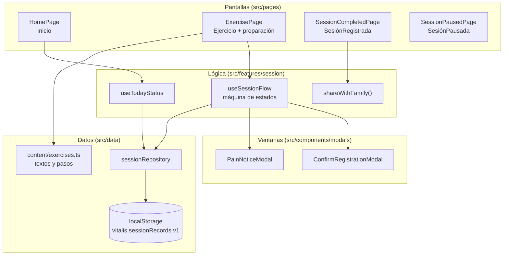
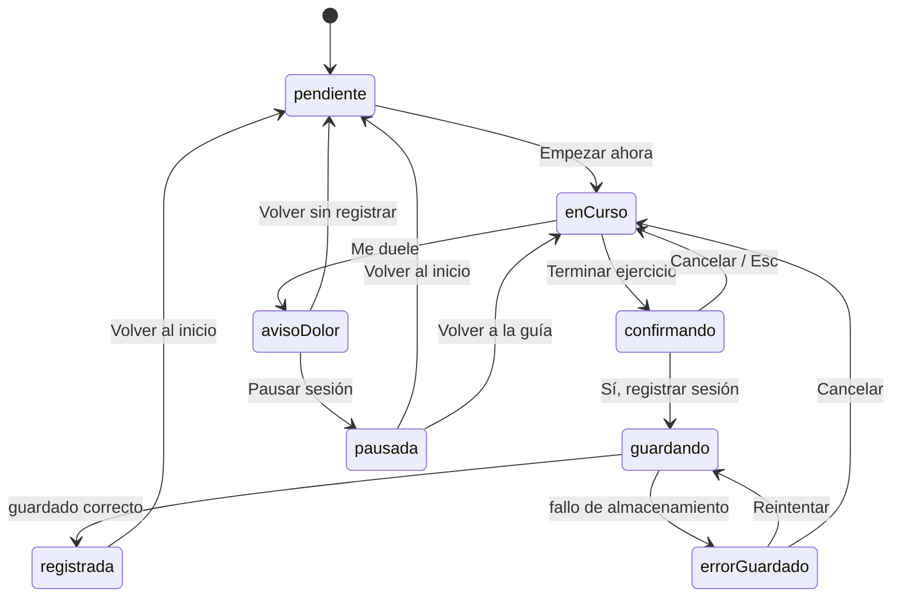

# plan.md · Vitalis — Plan técnico del MVP

> Equipo NexoTeam · G02-01, G02-02, G02-03
> Implementa: [spec.md](spec.md) · Respeta: [constitution.md](constitution.md) · Se desglosa en: [tasks.md](tasks.md) · Decisiones posteriores: [decisiones.md](decisiones.md)
> Estado: propuesta para revisión del equipo · 15/10/2026 · actualizado con DEC-01 el 16/10/2026

## 1. Resumen

Construimos **una aplicación web para móvil, sin servidor**, con React y TypeScript, que guarda los registros de sesión en el propio dispositivo. Es la opción más pequeña que cumple todo el spec: se abre con un enlace en el móvil de la usuaria, se prueba de forma automática y no hay que instalar nada.

> **DEC-01 (16/10/2026):** el MVP es **solo móvil**. Se diseña para 390 × 844 px y se verifica entre 320 y 768 px. En pantallas más anchas el contenido se centra con un ancho máximo de 390 px (CL-13). Las pantallas `*/Desktop` de Figma quedan como referencia visual.

Esfuerzo estimado: **~62 horas de equipo** tras DEC-01 (antes 81 h), más 6 h conjuntas del test de usabilidad, repartidas en 4 semanas (ver tasks.md).

---

## 2. Tecnologías y justificación

| Necesidad | Elección | Por qué | Alternativa descartada y motivo |
| --- | --- | --- | --- |
| Interfaz | **React 18 + TypeScript (strict)** | El equipo ya conoce JavaScript (la ideación eligió React Native por ese motivo). Los tipos evitan errores en el modelo de datos. | React Native: obliga a emuladores o dispositivos y a publicar o instalar la app para el piloto. La lógica y los componentes de React se reaprovechan si más adelante se pasa a React Native. |
| Proyecto y build | **Vite** | Arranque y recarga rápidos; plantilla oficial `react-ts`; build estático. | Create React App: sin mantenimiento. |
| Navegación | **React Router** | Una ruta por pantalla de Figma; permite redirecciones (RF-17). | Navegación por estado: no permite recargar ni enlazar pantallas. |
| Estilos | **CSS Modules + variables CSS** con los tokens de Figma | Sin dependencias extra; los tokens (colores, tipografía, espaciado) se copian 1:1 de las variables de Figma. | Librería de componentes (MUI, etc.): pesa más y cuesta adaptarla a los tamaños mínimos de la constitución (A-1, A-2). |
| Ventanas modales | Elemento nativo **`<dialog>`** | Retiene el foco y se cierra con Esc de forma nativa (RNF-05). | Librería de modales: dependencia innecesaria. |
| Datos | **`localStorage`** detrás de un repositorio (`sessionRepository`) | El MVP no tiene cuentas (P-2). El repositorio aísla el almacenamiento: mañana se cambia por una API sin tocar las pantallas. | Firebase o Node + PostgreSQL (propuestos en la ideación): necesarios para Reto en Familia y las cuentas, excluidos del MVP. |
| Avisar a la familia | **Web Share API** (`navigator.share`) con alternativa `wa.me` + portapapeles | Abre la hoja de compartir del móvil: la usuaria elige a quién; la app no toca contactos (P-4). | Envío propio por SMS o correo: exige servidor y datos de contacto. |
| Tests unitarios y de componentes | **Vitest + React Testing Library + jsdom** | Integrados con Vite; prueban lo que ve la usuaria (textos y roles accesibles). | Jest: configuración extra con Vite. |
| Tests e2e y accesibilidad | **Playwright + @axe-core/playwright** | Prueban el flujo completo en Chromium y WebKit con perfil de móvil, y auditan la accesibilidad (RNF-06). | Cypress: no prueba WebKit (Safari), importante para iPhone. |
| Calidad | **ESLint + eslint-plugin-jsx-a11y + Prettier** | Detecta errores de accesibilidad mientras se escribe. | — |
| Iconos y fuentes | SVG exportados de Figma y fuente del sistema, **servidos desde el propio proyecto** | Cumple P-3 (cero terceros). Las licencias de los iconos se comprueban al exportar (pendiente del handoff de Figma). | Google Fonts o CDN de iconos: peticiones a terceros. |
| Despliegue | **Vercel (plan gratuito)**, con GitHub Pages como alternativa | Publica cada rama con un enlace propio: útil para revisar *pull requests* y para abrirlo en el móvil del piloto. | — |

---

## 3. Arquitectura



### 3.1 Estados de la sesión

La lógica del flujo es una máquina de estados pequeña (`useReducer`), probada con tests unitarios. Las pantallas solo leen el estado y lanzan eventos.



> DEC-01: desaparecen los estados y transiciones de escritorio (`preparando`, y «Pausar sesión» desde `enCurso`).

Solo la transición `guardando → registrada` escribe en el almacenamiento. Ninguna otra transición crea registros (RF-08, RF-09, RF-10, RF-11).

---

## 4. Datos

### 4.1 Qué se guarda

```ts
// src/data/types.ts
export type ExerciseId = 'sit-to-stand'; // «Levantarse de la silla»

export interface SessionRecord {
  id: string;              // crypto.randomUUID()
  exerciseId: ExerciseId;
  status: 'completed';     // las pausas NO se guardan
  completedAt: string;     // ISO 8601 con zona horaria local
  schemaVersion: 1;
}
```

- **Dónde:** `localStorage`, clave `vitalis.sessionRecords.v1`, como un array JSON de `SessionRecord`.
- **Qué no se guarda:** nombre, edad, contactos, datos de salud, pausas ni motivos de dolor (P-1, P-5).
- **Sesión del día:** `useTodayStatus` filtra los registros cuya fecha local coincide con hoy (RF-13, CL-07).
- **Lectura segura:** si el JSON no es válido o no cumple el tipo, se devuelve `[]` y se registra un aviso en consola (RF-18).
- **Escritura segura:** `save()` captura las excepciones de `localStorage` (cuota llena, modo privado) y devuelve un resultado `ok | error`, que la interfaz usa para RF-15.
- **Versión:** `schemaVersion` y el sufijo `.v1` permiten migrar el formato sin perder datos.

### 4.2 Contenido estático

`src/content/exercises.ts` contiene el ejercicio (nombre, nivel, 8 repeticiones, 30 s de descanso, ~5 min), la lista de preparación, los pasos, el aviso de salud y todos los textos de botones. Un solo archivo facilita la revisión de lenguaje (RNF-11, C-5) y la validación de los pasos (D-10).

---

## 5. Relación con las pantallas de Figma

Solo se implementan las pantallas `*/Mobile`.

| Pantalla Figma (`07_ReadyForDev`) | Ruta | Componente | Requisitos |
| --- | --- | --- | --- |
| Inicio/Mobile | `/` | `HomePage` | RF-01, RF-13, RF-14, RF-19 |
| Ejercicio/Mobile | `/rutina/ejercicio` | `ExercisePage` + `PreparationChecklist` | RF-04, RF-05 |
| ConfirmarRegistro/Mobile | ventana sobre `/rutina/ejercicio` | `ConfirmRegistrationModal` | RF-06, RF-07, RF-08, RF-15, RF-16 |
| AvisoDolor/Mobile | ventana sobre `/rutina/ejercicio` | `PainNoticeModal` | RF-09, RF-11 |
| SesiónRegistrada/Mobile | `/rutina/registrada` | `SessionCompletedPage` | RF-07, RF-12, RF-17 |
| SesiónPausada/Mobile | `/rutina/pausada` | `SessionPausedPage` | RF-10, RF-17 |
| Navegación inferior (Inicio · Mi Rutina · Mi Plato · Familia) | — | `AppShell` (solo barra inferior) | RF-19, RNF-07 |
| ~~Preparación/Desktop y el resto de `*/Desktop`~~ | — | No se implementan (DEC-01) | — |

| Componente Figma (`05_Components`) | Componente React |
| --- | --- |
| Button/Primary (Default, Hover) | `Button variant="primary"` |
| Button/Secondary | `Button variant="secondary"` |
| Button/Return | `Button variant="return"` |
| Badge/Session | `Badge` |

**Tamaños:** columna única de **390 px como máximo**, centrada; las ventanas modales miden 350 px de ancho como máximo, como en Figma. No hay punto de corte de escritorio: en anchos mayores a 390 px solo crece el margen (CL-13).

**Diferencias deliberadas respecto al Figma** (anotadas en spec.md §7): las tarjetas de Mi Plato y Reto en Familia salen como «Próximamente», sin cifras (D-04), y el saludo no lleva nombre hasta resolver D-06.

---

## 6. Estructura de carpetas

La estructura sigue la que pide la entrega del MVP.

```
.
├── README.md                 # propósito, instalación, comandos, limitaciones
├── validacion.md             # qué se ha comprobado, cómo y con qué resultado
├── uso-ia.md                 # registro del uso de IA
├── evidencias-ia/            # capturas de los casos de uso-ia.md
├── .env.example              # no hace falta ninguna variable; está para dejarlo claro
├── docs/
│   ├── AGENTS.md             # cómo se trabaja aquí (personas y asistentes de IA)
│   ├── constitution.md
│   ├── spec.md
│   ├── plan.md
│   ├── tasks.md
│   ├── decisiones.md         # decisiones posteriores al SDD inicial (DEC-01)
│   ├── design-thinking/
│   ├── figma/                # enlace, textos y capturas del prototipo
│   └── presentacion.pdf
├── scripts/
│   └── check-contrast.mjs    # verifica el contraste de los tokens (RNF-03)
├── src/
│   ├── app/                  # AppShell, router, estilos globales y tokens
│   ├── components/           # Button, Badge, Modal, PreparationChecklist, HealthNotice
│   │   └── modals/           # ConfirmRegistrationModal, PainNoticeModal
│   ├── content/exercises.ts  # todos los textos de la interfaz (C-5)
│   ├── data/                 # types.ts, sessionRepository.ts
│   ├── features/session/     # useSessionFlow, useTodayStatus, shareWithFamily
│   ├── pages/                # una página por pantalla de Figma
│   └── test/                 # utilidades de los tests
└── tests/e2e/                # Playwright + axe
```

Los tests unitarios y de componentes viven **junto al archivo que prueban** (`sessionRepository.test.ts` al lado de `sessionRepository.ts`); los e2e, en `tests/e2e/`.

> CLAUDE.md se queda en la raíz porque es donde lo busca la herramienta; solo apunta a `docs/AGENTS.md`.

---

## 7. Estrategia de pruebas

| Nivel | Herramienta | Qué se prueba | Requisitos | Cuándo |
| --- | --- | --- | --- | --- |
| Unitario | Vitest | Máquina de estados (todas las transiciones), `sessionRepository` (guardar, leer, JSON corrupto, almacenamiento bloqueado), cálculo de «hoy», `shareWithFamily` con y sin Web Share | RF-07, RF-08, RF-13, RF-15, RF-16, RF-18, RF-12 | En cada commit |
| Componente | Vitest + Testing Library | Textos exactos de botones, aviso de salud, foco al abrir y cerrar ventanas, botón desactivado al guardar | RF-05, RF-06, RF-09, RNF-05, RNF-10 | En cada commit |
| End-to-end | Playwright (Chromium y WebKit, perfil móvil 390 × 844) | Ruta principal, registro y recarga, cancelar, dolor y pausa, acceso directo a resultados, solo teclado | RF-01, RF-04 a RF-17 | En cada *pull request* |
| Accesibilidad | @axe-core/playwright | 0 violaciones *serious* o *critical* en las 6 pantallas | RNF-03, RNF-06, RNF-12 | En cada *pull request* |
| Adaptable | Playwright | Sin desplazamiento horizontal a 320, 390 y 768 px; botones ≥ 48 px | RNF-01, RNF-07 | En cada *pull request* |
| Privacidad | Playwright | Falla si hay peticiones a dominios distintos del propio | RNF-08 | En cada *pull request* |
| Manual | Lector de pantalla (VoiceOver o TalkBack), zoom 200 %, escala de grises | Lectura del flujo, zoom, estados sin color | RNF-02, RNF-04, RNF-12 | Antes del test de usabilidad |
| Usabilidad | Guion de `08_Test` de Figma, en un móvil real | 1 o 2 personas de 65 años o más completan la tarea sin instrucciones de clic; 3 observaciones y 1 mejora aplicada | Objetivo del MVP | Semana 4 |
| Rendimiento | Lighthouse (móvil) | Accesibilidad ≥ 95, Rendimiento ≥ 85 | RNF-09 | Antes de la entrega final |

**Definición de hecho de una tarea:** cumple su «hecho cuando…» de tasks.md, tiene tests que nombran el RF, pasa lint, tests y build, y lo ha revisado otro integrante en un *pull request*.

---

## 8. Calendario

| Semana | Objetivo | Tareas |
| --- | --- | --- |
| 1 | Proyecto creado, tokens, componentes base y datos | T-00 a T-07 |
| 2 | Flujo principal completo (Inicio → Registrada) | T-08, T-10, T-11, T-13 |
| 3 | Dolor, pausa, errores y suite de pruebas | T-12, T-14 a T-19 |
| 4 | Test con personas mayores, mejora y despliegue | T-20 a T-22 |

Las fechas exactas dependen del calendario del módulo (pendiente de confirmar con el docente).

---

## 9. Riesgos

| Riesgo | Impacto | Mitigación |
| --- | --- | --- |
| Falta de tiempo | No se termina el flujo | El alcance ya es un solo ejercicio y solo móvil (DEC-01); RF-12 y RF-14 son los primeros que se recortan si hace falta, con acuerdo del equipo (M-2). |
| `localStorage` bloqueado (Safari en modo privado) | No se puede registrar | RF-15: aviso y reintento; probado en WebKit. |
| Web Share no disponible | No se puede avisar a la familia | Alternativa WhatsApp + copiar mensaje (CA-12.1). |
| Ventanas modales poco accesibles | Usuarias de teclado o lector atrapadas | `<dialog>` nativo + tests de foco + axe. |
| No encontrar personas mayores para el test | Sin validación real | Pedir ayuda a familiares del equipo con antelación (semana 2). |
| Pasos del ejercicio poco seguros | Riesgo físico | Validación con una fuente fiable antes del piloto (D-10, S-6). |
| El docente esperaba también la versión de escritorio | Nota más baja en responsive | Comentar DEC-01 con el docente antes de T-02 (D-11). El responsive sigue probándose entre 320 y 768 px. |

---

## 10. Revisión del plan

| Integrante | Revisado | Comentarios |
| --- | --- | --- |
| G02-01 | ☐ | |
| G02-02 | ☐ | |
| G02-03 | ☐ | |
