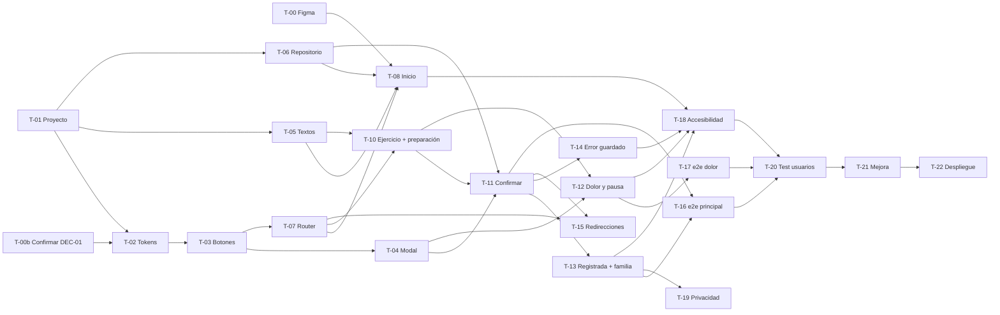

# tasks.md · Vitalis — Tareas del MVP

> Equipo NexoTeam · Isaac, Iker, Enzo
> Basado en: [spec.md](spec.md) y [plan.md](plan.md) · Reglas: [constitution.md](constitution.md) · Decisiones: [decisiones.md](decisiones.md)
> Actualizado con DEC-01 (solo app móvil) el 16/10/2026.

**Cómo usar este archivo**
- Una rama por tarea: `T-xx-descripcion-corta`. El *pull request* lo revisa otro integrante (C-4).
- Una tarea se cierra solo cuando cumple su **«Hecho cuando…»** y la definición de hecho de plan.md §7.
- Si una tarea cambia un requisito, se actualiza antes spec.md.
- Estado: ☐ pendiente · ◐ en curso · ☑ hecha.

---

## Fase 0 · Preparación

| ID | Tarea | Requisito | Depende de | Responsable | Horas | Hecho cuando… | Estado |
| --- | --- | --- | --- | --- | --- | --- | --- |
| T-00 | Cerrar los pendientes del Figma que afectan al desarrollo: revisión en Present (flujo móvil), retorno de Hover, nombres del equipo (Isaac), persona única (Rosa o Carmen), acceso del docente | D-03, D-08, D-09 | — | Iker | 3 | Present recorre la ruta móvil principal y las alternativas sin enlaces rotos, el docente abre el archivo y los nombres están corregidos. | ☐ |
| T-00b | Confirmar DEC-01 con Iker y Enzo (y comentarlo con el docente) y terminar de volcarla en spec.md, plan.md y Figma | D-11, M-2, M-4 | — | Isaac | 1 | Los tres han dicho que sí por escrito, la lista de pendientes de `decisiones.md` está toda marcada y el Figma anota que Desktop no se implementa. | ☐ |
| T-01 | Crear el repositorio en GitHub y el proyecto Vite `react-ts` con TypeScript `strict`. Copiar los documentos SDD a `docs/sdd/` | C-1 | — | Isaac | 2 | `typecheck`, `build` y `dev` funcionan y los comandos reales están anotados en AGENTS.md §6. | ☑ |
| T-01b | Añadir el tooling de calidad que falta: ESLint (+ jsx-a11y), Prettier, Vitest + Testing Library y Playwright + axe (perfil móvil) | C-2, C-3 | T-01 | Isaac | 3 | `npm run lint`, `npm run test` y `npm run test:e2e` existen y pasan, y AGENTS.md §6 queda sin avisos. | ☐ |
| T-01c | Prototipo recorrible del flujo móvil completo (Inicio → Ejercicio → Confirmar → Registrada / Pausada) para poder enseñarlo y probarlo a mano | RF-01, RF-04 a RF-13 | T-01 | Isaac | 4 | El flujo se recorre entero en un móvil real sin pantallas rotas. **Es un prototipo: no sustituye a T-05 a T-15, que lo rehacen con tests.** | ☑ |

## Fase 1 · Base

| ID | Tarea | Requisito | Depende de | Responsable | Horas | Hecho cuando… | Estado |
| --- | --- | --- | --- | --- | --- | --- | --- |
| T-02 | Pasar los tokens de Figma (colores, tipografía, espaciado, radios) a variables CSS | RNF-02, RNF-03 | T-01 | Iker | 3 | Los colores de texto y botón cumplen 4,5:1 / 3:1 (comprobado con un verificador de contraste) y el cuerpo mide ≥ 18 px. | ☐ |
| T-03 | Componentes `Button` (primary, secondary, return), `Badge` y `Card` | RNF-01, RNF-04, RNF-12 | T-02 | Iker | 4 | Los tres botones miden ≥ 48 × 48 px, tienen foco visible y un test de componente por variante. | ☐ |
| T-04 | Componente `Modal` sobre `<dialog>`: retiene el foco, Esc cierra y el foco vuelve al botón de origen | RNF-05 | T-03 | Enzo | 4 | Un test de componente comprueba el foco al abrir, Esc y el retorno del foco. | ☐ |
| T-05 | Archivo `content/exercises.ts` con todos los textos de Figma (preparación, pasos, botones, aviso de salud) revisados con A-7 | RF-05, RNF-10, RNF-11 | T-01 | Enzo | 2 | Dos integrantes han revisado los textos y ninguna frase supera las 20 palabras. | ☐ |
| T-06 | `sessionRepository` (`list`, `save`) sobre `localStorage` y `useTodayStatus` | RF-07, RF-13, RF-15, RF-18 | T-01 | Isaac | 4 | Hay tests unitarios para guardar y leer, JSON corrupto (`[]`), almacenamiento bloqueado (`error`) y cambio de día a las 00:00. | ☐ |
| T-07 | Router y `AppShell` con **barra inferior únicamente**; contenedor de 390 px centrado; Mi Plato y Familia como «Próximamente» | RF-19, RNF-07, DEC-01 | T-03 | Isaac | 2 | Las 4 rutas existen, no hay desplazamiento horizontal a 320 px, en 1440 px el contenido se centra sin romperse (CL-13) y Mi Plato y Familia no navegan. | ☐ |

## Fase 2 · Flujo principal

| ID | Tarea | Requisito | Depende de | Responsable | Horas | Hecho cuando… | Estado |
| --- | --- | --- | --- | --- | --- | --- | --- |
| T-08 | Pantalla Inicio (móvil): saludo por hora, tarjeta «Mi Rutina · Hoy» con estado Pendiente / Hecha hoy, «Empezar ahora», «Hoy tengo dolor o no puedo» y tarjetas «Próximamente» | RF-01, RF-13, RF-14, RF-19 | T-05, T-06, T-07 | Iker | 3 | Los tests cubren CA-01.1, CA-01.2 y CA-13.1 y la pantalla coincide con Inicio/Mobile salvo D-04 y D-06. | ☐ |
| ~~T-09~~ | ~~Pantalla Preparación (escritorio)~~ **Eliminada por DEC-01.** La preparación y el `HealthNotice` se construyen dentro de T-10. | — | — | — | 0 | — | ✖ |
| T-10 | Pantalla Ejercicio (móvil): `PreparationChecklist` **antes** de los pasos, `HealthNotice`, pasos numerados, insignias, «Terminar ejercicio» y «Me duele» | RF-04, RF-05, RNF-10 | T-05, T-07 | Enzo | 5 | «Me duele» es visible sin desplazarse a 390 × 844 px, la preparación aparece antes de los pasos y el aviso de salud es visible. | ☐ |
| T-11 | `useSessionFlow` (máquina de estados de plan.md §3.1) + `ConfirmRegistrationModal`: confirmar guarda, cancelar o Esc no guarda, botón desactivado mientras guarda | RF-06, RF-07, RF-08, RF-16 | T-04, T-06, T-10 | Isaac | 5 | Hay tests unitarios de cada transición y un test de componente que demuestra que una doble pulsación crea un solo registro. | ☐ |
| T-13 | Pantalla SesiónRegistrada + `shareWithFamily` (Web Share; si no, WhatsApp y Copiar mensaje) | RF-07, RF-12 | T-11 | Isaac | 4 | En móvil se abre la hoja de compartir; sin Web Share aparecen las dos alternativas; cancelar no muestra error (tests con `navigator.share` simulado). | ☐ |

## Fase 3 · Alternativas, errores y validación

| ID | Tarea | Requisito | Depende de | Responsable | Horas | Hecho cuando… | Estado |
| --- | --- | --- | --- | --- | --- | --- | --- |
| T-12 | `PainNoticeModal` y pantalla SesiónPausada («No registrada como completada», «Volver al inicio», «Volver a la guía») | RF-09, RF-10, RF-11 | T-04, T-10 | Iker | 3 | Ninguna acción de esta ruta crea registros (test) y el estado se muestra con icono + texto. | ☐ |
| T-14 | Aviso de fallo de guardado con «Reintentar» dentro de ConfirmarRegistro | RF-15 | T-11 | Enzo | 2 | Con `localStorage` simulado que falla se muestra el aviso, no se navega a SesiónRegistrada y «Reintentar» funciona cuando el guardado vuelve a ir bien. | ☐ |
| T-15 | Redirección a Inicio al abrir directamente `/rutina/registrada` o `/rutina/pausada` | RF-17 | T-07, T-11 | Iker | 2 | Un test e2e abre ambas direcciones y acaba en `/`. | ☐ |
| T-16 | Tests e2e de la ruta principal con perfil móvil (390 × 844): registro, recarga, segundo registro del día y cancelar | RF-01, RF-04 a RF-08, RF-13 | T-11, T-13 | Enzo | 3 | La suite pasa en Chromium y WebKit y cubre CL-01, CL-04 y CL-06. | ☐ |
| T-17 | Tests e2e de la ruta de dolor y pausa y de «Hoy tengo dolor o no puedo» | RF-09, RF-10, RF-11, RF-14 | T-12 | Iker | 3 | La suite cubre CL-08 y comprueba que no hay registros nuevos. | ☐ |
| T-18 | Auditoría de accesibilidad: axe en las 6 pantallas, flujo solo con teclado, 320 / 390 / 768 px, botones ≥ 48 px, zoom 200 %, escala de grises y lector de pantalla | RNF-01 a RNF-07, RNF-12 | T-08, T-10 a T-14 | Isaac | 4 | 0 violaciones *serious* o *critical*, sin desplazamiento horizontal y una lista de comprobación manual firmada en el PR. | ☐ |
| T-19 | Test de privacidad (sin peticiones a terceros) y revisión de dependencias e iconos (licencias, sin CDN) | RNF-08, P-1 a P-4 | T-13 | Enzo | 2 | Un test e2e falla si aparece una petición externa y las licencias de los iconos están anotadas en el README. | ☐ |

## Fase 4 · Usabilidad, mejora y entrega

| ID | Tarea | Requisito | Depende de | Responsable | Horas | Hecho cuando… | Estado |
| --- | --- | --- | --- | --- | --- | --- | --- |
| T-20 | Test de usabilidad en un móvil real con 1 o 2 personas de 65 años o más usando el guion de `08_Test` (sin instrucciones de clic). Validar antes los pasos del ejercicio (D-10) | Objetivo del MVP, D-07, D-10 | T-16, T-17, T-18 | Todo el equipo (coordina Iker) | 6 | Hay 3 observaciones registradas (hecho observado, impacto, decisión) y un problema prioritario elegido. | ☐ |
| T-21 | Aplicar la mejora prioritaria del test y actualizar spec.md, plan.md y tasks.md si cambia algo | Según T-20 | T-20 | Enzo | 3 | La mejora está fusionada, todos los tests pasan y los documentos SDD reflejan el cambio. | ☐ |
| T-22 | Desplegar el piloto en Vercel, README con instrucciones y Lighthouse (móvil) | RNF-09 | T-21 | Isaac | 3 | El enlace público funciona en un móvil real, Lighthouse da Accesibilidad ≥ 95 y Rendimiento ≥ 85 y el informe está en el repo. | ☐ |

---

## Resumen del reparto

| Integrante | Tareas | Horas |
| --- | --- | --- |
| Isaac | T-00b, T-01, T-06, T-07, T-11, T-13, T-18, T-22 | 27 |
| Iker | T-00, T-02, T-03, T-08, T-12, T-15, T-17 (+ coordinación de T-20) | 23 |
| Enzo | T-04, T-05, T-10, T-14, T-16, T-19, T-21 | 21 |
| Todo el equipo | T-20 | 6 |
| **Total** | **22 tareas** | **77** |

> Nota: el total baja respecto a las 81 h iniciales porque DEC-01 elimina T-09 y recorta T-07, T-10 (absorbe parte de T-09), T-12, T-16 y T-18. El reparto queda pendiente de que Iker y Enzo lo acepten (T-00b).

## Orden y dependencias

**Camino crítico:** T-01 → T-02 → T-03 → T-04 → T-11 → T-13 → T-16 → T-20 → T-21 → T-22. Un retraso en cualquiera de ellas retrasa la entrega.

**Si falta tiempo** (regla M-2, con acuerdo del equipo): se recorta primero RF-14 (T-08 parcial) y después las alternativas de RF-12 (CA-12.1), nunca la ruta de dolor ni las pruebas de accesibilidad.
